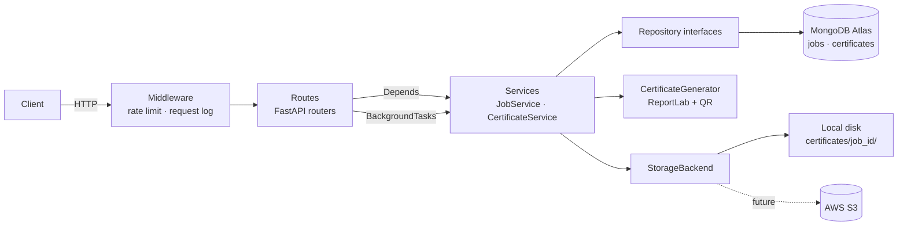

# Bulk Certificate Generator Backend API

Production-style FastAPI service that accepts a bulk certificate request, validates
recipients, generates PDF certificates (ReportLab) in the background, tracks progress,
isolates per-certificate failures, and serves downloads and public verification.

**Stack:** Python 3.11+, FastAPI, MongoDB Atlas, Motor, Pydantic v2, ReportLab, Pytest, Docker, JWT, BackgroundTasks.

---

## Table of contents
1. [Features](#features)
2. [Project structure](#project-structure)
3. [Architecture](#architecture)
4. [Setup](#setup)
5. [Environment variables](#environment-variables)
6. [MongoDB Atlas setup](#mongodb-atlas-setup)
7. [Run the application](#run-the-application)
8. [Run tests](#run-tests)
9. [API examples](#api-examples)
10. [Swagger usage](#swagger-usage)
11. [Docker deployment](#docker-deployment)
12. [Design decisions](#design-decisions)
13. [Known limitations / next steps](#known-limitations--next-steps)

---

## Features
- `POST /api/v1/jobs` returns **202 immediately**; PDFs are generated in a background task
- Progress persisted **after every certificate** (`progress_percentage = (success + failed) / total * 100`)
- One bad certificate never stops the job; error stored per certificate; failed recipients returned by the status API
- Validation: name required / min length 3, email format, duplicate emails (case-insensitive), empty list rejected, max 1000 recipients
- PDF: template background, title, name, course, event, date, organisation, signature area, certificate ID, **QR code → verification URL**
- Storage: `certificates/{job_id}/certificate_<uuid>.pdf` behind a `StorageBackend` interface (**S3-ready**)
- Structured JSON logging, consistent JSON error bodies, request IDs
- **Bonus:** pagination, status filter, search by name, JWT auth, rate limiting, `GET /verify/{id}`

## Project structure
```
project/
├── app/
│   ├── main.py            # app factory (dependency wiring, middleware, routers)
│   ├── config.py          # typed settings from env
│   ├── database.py        # Motor client lifecycle
│   ├── models/            # persistence models + enums (jobs, certificates)
│   ├── schemas/           # request/response contracts + validation
│   ├── routes/            # thin HTTP layer
│   ├── services/          # business logic (JobService, CertificateService, auth)
│   ├── repositories/      # base interfaces, Mongo + in-memory implementations
│   ├── utils/             # pdf_generator, storage (local/S3), logging, exceptions
│   └── middleware/        # rate limiting, request logging
├── certificates/          # generated PDFs (gitignored)
├── templates/             # certificate_template.png
├── scripts/generate_template.py
├── tests/
├── requirements.txt  Dockerfile  docker-compose.yml  .env.example  README.md
```

## Architecture


**Request flow (create job):** validate → save job (`PENDING`) → respond `202` →
background task sets `PROCESSING` → for each recipient: render PDF (worker thread) → store
file → save certificate record → `$inc` counters → finally `COMPLETED` (or `FAILED` if *every*
certificate failed).

## Setup
```bash
python3.11 -m venv .venv && source .venv/bin/activate
pip install -r requirements.txt
cp .env.example .env            # then edit values
python scripts/generate_template.py   # only if you want to regenerate the default template
```

## Environment variables
| Variable | Default | Description |
|---|---|---|
| `MONGODB_URI` | `mongodb://localhost:27017` | Mongo / Atlas connection string |
| `MONGODB_DB_NAME` | `certificate_db` | Database name |
| `BASE_URL` | `http://localhost:8000` | Public URL used inside QR codes |
| `ORGANIZATION_NAME` | `Example Academy` | Printed on the certificate |
| `CERTIFICATES_DIR` | `certificates` | Local storage root |
| `TEMPLATE_PATH` | `templates/certificate_template.png` | Background image |
| `STORAGE_BACKEND` | `local` | `local` or `s3` (`S3_BUCKET`, `S3_REGION`; needs `boto3`) |
| `AUTH_ENABLED` | `true` | Require JWT on `/api/v1/jobs*` and `/api/v1/certificates*` |
| `JWT_SECRET` / `JWT_ALGORITHM` / `JWT_EXPIRE_MINUTES` | `change-me` / `HS256` / `60` | Token settings |
| `ADMIN_USERNAME` / `ADMIN_PASSWORD` | `admin` / `admin123` | Demo credentials for `/api/v1/auth/token` |
| `RATE_LIMIT_PER_MINUTE` | `120` | Per-IP limit (`/health` exempt) |
| `LOG_LEVEL` | `INFO` | Logging level |

> Change `JWT_SECRET` and `ADMIN_PASSWORD` before deploying anywhere real.

## MongoDB Atlas setup
1. Create a free account at <https://cloud.mongodb.com> and a **free M0 cluster**.
2. **Database Access → Add Database User** (username + password, "Read and write to any database").
3. **Network Access → Add IP Address** – your IP (or `0.0.0.0/0` for testing only).
4. **Connect → Drivers** → copy the `mongodb+srv://…` string.
5. Put it in `.env`:
   ```
   MONGODB_URI=mongodb+srv://<user>:<password>@<cluster>.mongodb.net/?retryWrites=true&w=majority
   MONGODB_DB_NAME=certificate_db
   ```
   URL-encode special characters in the password. Collections and indexes are created automatically on startup.

## Run the application
```bash
uvicorn app.main:app --reload
# Swagger UI  -> http://localhost:8000/docs
# ReDoc       -> http://localhost:8000/redoc
```

## Run tests
The suite uses in-memory repositories and a temp directory, so **no MongoDB is needed**.
```bash
pytest -v
```
Covers: create job, validation, empty list, invalid email, duplicate email, PDF generation,
status API, download API, individual certificate failure, background processing/progress,
pagination/search/filter, verification, JWT auth, rate limiting.

## API examples
(With `AUTH_ENABLED=false`, omit the `Authorization` header.)

```bash
# 0. Get a token
TOKEN=$(curl -s -X POST localhost:8000/api/v1/auth/token \
  -H 'Content-Type: application/json' \
  -d '{"username":"admin","password":"admin123"}' | python -c "import sys,json;print(json.load(sys.stdin)['access_token'])")

# 1. Create a bulk job  -> 202 {"job_id": "...", "status": "PENDING", "message": "Certificate generation started"}
curl -X POST localhost:8000/api/v1/jobs -H "Authorization: Bearer $TOKEN" \
  -H 'Content-Type: application/json' -d '{
    "course_name": "Python Bootcamp",
    "event_name": "AI Workshop",
    "issue_date": "2026-10-10",
    "recipients": [{"name": "Abhinandan Mahanta", "email": "abhi@gmail.com"}]
  }'

# 2. Job status
curl localhost:8000/api/v1/jobs/<job_id> -H "Authorization: Bearer $TOKEN"
# {"job_id":"...","status":"PROCESSING","total":100,"success":60,"failed":5,
#  "progress_percentage":65.0,"failed_recipients":[{"recipient_name":"...","email":"...","error_message":"..."}], ...}

# 3. List certificates (pagination + filter + search); total count is in the X-Total-Count header
curl "localhost:8000/api/v1/jobs/<job_id>/certificates?page=1&page_size=20&status=SUCCESS&search=abhi" \
  -H "Authorization: Bearer $TOKEN"

# 4. Download PDF
curl -OJ localhost:8000/api/v1/certificates/<certificate_id>/download -H "Authorization: Bearer $TOKEN"

# 5. Public verification (the QR code points here) -> {"valid": true, "recipient": "John Doe", ...}
curl localhost:8000/verify/<certificate_id>

# 6. Health
curl localhost:8000/health   # {"status":"healthy"}
```

**Error format** (all errors):
```json
{"error": {"code": "validation_error", "message": "Request validation failed",
           "details": [{"field": "recipients.0.email", "message": "value is not a valid email address…"}]}}
```

## Swagger usage
1. Open `/docs`.
2. Call **POST /api/v1/auth/token** with your credentials, copy `access_token`.
3. Click **Authorize** (top right) and paste the token (no `Bearer ` prefix needed).
4. Use **POST /api/v1/jobs** → *Try it out*, then poll **GET /api/v1/jobs/{job_id}**.

## Docker deployment
```bash
cp .env.example .env
docker compose up --build -d      # API on :8000, MongoDB on :27017
docker compose logs -f api
docker compose down               # add -v to also delete volumes
```
`docker-compose.yml` overrides `MONGODB_URI` to point at the bundled `mongo` service. To use
Atlas instead, delete that override (and the `mongo` service) and keep your Atlas URI in `.env`.
Generated PDFs persist in the `certificates_data` volume.

## Design decisions
- **Layered / clean architecture:** routes (HTTP) → services (business rules) → repositories (persistence). Routes contain no logic; services never import Motor.
- **Repository pattern + Dependency Inversion:** services depend on abstract repositories. The same interfaces have Mongo and in-memory implementations, which makes tests fast and DB-free.
- **App factory with injectable collaborators:** `create_app(...)` lets tests swap repositories, storage, and the certificate generator (e.g. a generator that fails on demand).
- **BackgroundTasks over Celery:** meets the requirement with zero extra infrastructure. Trade-off: jobs run in the API process and an in-flight job is lost on restart (see limitations).
- **CPU-bound PDF work in `asyncio.to_thread`:** keeps the event loop responsive while rendering.
- **Failure isolation:** `_process_recipient` catches everything per certificate, stores a `FAILED` record with the error, and the loop continues. A job is `FAILED` only if no certificate succeeded (or on an infrastructure crash).
- **Atomic progress:** counters are updated with Mongo `$inc`, so progress is accurate even if updates ever become concurrent.
- **Storage abstraction:** `StorageBackend` (local now, `S3Storage` ready). `file_path` stores the backend location (`/certificates/...` or `s3://...`); path-traversal is blocked in `LocalStorage`.
- **202 Accepted** for job creation because the work is asynchronous.
- **List endpoint returns a plain array** (per the API contract); pagination metadata is in `X-Total-Count`, `X-Page`, `X-Page-Size` headers.
- **Search safety:** user search text is `re.escape`d before use in a Mongo regex.
- **Pydantic v2 validation at the boundary:** names/emails normalised (trimmed, lower-cased emails) so duplicate detection is case-insensitive.
- **Public vs protected:** `/health`, `/verify/*` and the token endpoint are public (QR scans must work without login); everything that creates or downloads is JWT-protected.
- **Template as a plain PNG:** designers can replace `templates/certificate_template.png` with no code change (A4 landscape); a missing template falls back to a simple border.

## Known limitations / next steps
- In-flight jobs are not resumed after a crash/restart. Production fix: a durable queue (Celery/RQ/Arq) or a startup sweep that re-enqueues `PENDING`/`PROCESSING` jobs.
- Rate limiter is in-memory (per instance); use Redis for multi-replica deployments.
- Single demo admin user; replace with a users collection + hashed passwords for real multi-user auth.
- Failed certificates are not retried automatically; a `POST /jobs/{id}/retry` endpoint would be a natural addition.
